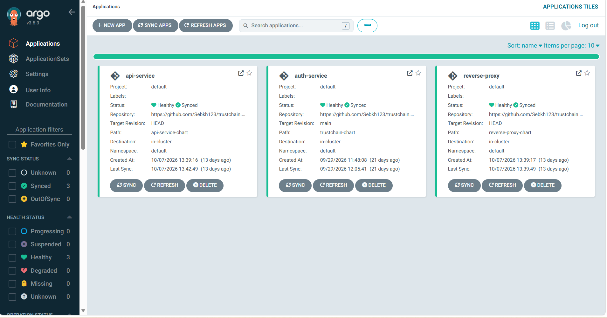
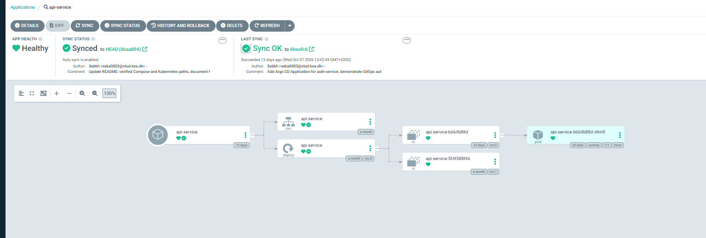

# trustchain

A layered networking and DevOps project, built step by step to understand how
traffic, identity and access control fit together, from raw JWT signing up to
GitOps and cloud network design.

```
Client --HTTPS 443--> reverse-proxy (Nginx) --HTTP--> auth-service (FastAPI, :8000)
                              |                             ^
                              +--HTTP--> api-service (FastAPI, :8002)
                                              |  fetches JWKS
                                              +-------------+
```

| Service | Role |
|---|---|
| **auth-service** | Issues RS256-signed JWTs (5-minute lifetime), publishes the public key at `/.well-known/jwks.json`, supports key rotation |
| **api-service** | Fetches the JWKS itself and verifies tokens independently; `/protected` requires a Bearer token |
| **reverse-proxy** | Terminates TLS and routes by path: `/auth/` to auth-service, `/api/` to api-service |

## What each layer demonstrates

### 1. Application: hand-rolled RS256 JWTs (Python/FastAPI)

No JWT library. Header and payload are JSON-encoded, base64url-encoded and
signed with RSA (PKCS1v15, SHA-256) explicitly, so every step is visible. The
signature is verified *before* the payload is parsed. Tokens carry a `kid`
derived from the public key, which lets api-service pick the right key from the
JWKS, and `exp`/`nbf` are enforced.

End-to-end test through the proxy (`python test_flow.py`):

```
Got token (truncated for display): eyJhbGciOiJSUzI1NiIsInR5cCI6IkpXVCIsImtpZCI6ImIxMT ...
Protected response: {"message":"Hello, seb. You accessed a protected resource.","claims":{"sub":"seb","iat":1792494930,"nbf":1792494930,"exp":1792495230}}
```

### 2. Containers: Docker Compose

All three services run together. Only the reverse proxy publishes a port on the
host; the services are reachable only through it. api-service takes its auth URL
from an environment variable instead of a hardcoded address.

### 3. Kubernetes: kind and Helm

One Helm chart per service. The proxy's configuration comes from a ConfigMap
and its certificate from a Secret.

### 4. Network policy: default-deny

A default-deny ingress policy with explicit allow rules:

- auth-service accepts traffic from reverse-proxy and api-service
- api-service accepts traffic from reverse-proxy
- reverse-proxy accepts traffic on 443 from anywhere

Enforcement was tested: a request from an arbitrary pod with no allow rule
fails once default-deny is applied.

```
kubectl run np-test --rm -it --image=curlimages/curl --restart=Never -- \
  curl -s -m 3 -o /dev/null -w "%{http_code}" http://auth-service:8000/healthz
000
```

`000` means the connection timed out and no response was received.

### 5. GitOps: Argo CD

All three services are Argo CD Applications that sync from this repository with
auto-sync, prune and self-heal.



The resource tree for one application shows the chain Argo manages: the
Application, its Service and Deployment, the ReplicaSets, and the Pod. The pod
is the one that was already running before Argo took over, so Argo adopted
existing resources instead of recreating them.



Two behaviours were demonstrated:

- Changing `replicaCount` in git created a new pod with no manual deploy.
- Scaling a deployment by hand to 5 replicas was reverted by Argo within seconds:

```
$ kubectl scale deployment api-service --replicas=5
deployment.apps/api-service scaled
$ kubectl get pods -w
api-service-b664b88d-c89x5   0/1   ContainerCreating   0   3s
api-service-b664b88d-zhtt8   1/1   Running             0   5s
api-service-b664b88d-sr94j   1/1   Running             0   6s
api-service-b664b88d-c89x5   0/1   Terminating         0   6s
api-service-b664b88d-zhtt8   1/1   Terminating         0   7s
api-service-b664b88d-sr94j   1/1   Terminating         0   7s
```

The extra pods were removed again within seconds. The original pod was never
touched.

### 6. Cloud network design: Terraform (Azure)

`terraform/` defines a VNet with two subnets (proxy and app). Each has a network
security group mirroring the Kubernetes policies: only 443 from the internet
into the proxy subnet, only the proxy subnet into the app subnet, and an
explicit deny-all. Azure allows all traffic inside a VNet by default, so the
deny rule is what makes the allow rules meaningful.

`terraform plan` reported `Plan: 8 to add, 0 to change, 0 to destroy.` After
`apply`, a second `plan` reported no changes, and the rules in Azure matched
the code:

```
$ az network nsg rule list -g rg-trustchain --nsg-name nsg-app -o table
Name               Priority  SourceAddressPrefixes  Access  Protocol  DestinationPortRanges
deny-all-inbound   4000      *                      Deny    *         *
allow-from-proxy   100       10.0.1.0/24            Allow   Tcp       8000 8002
allow-api-to-auth  110       10.0.2.0/24            Allow   Tcp       8000
```

Defense in depth: NSGs filter between subnets, NetworkPolicies filter between
pods, and api-service verifies the JWT signature itself, so no single layer is
trusted alone.

## Running it

The same test script works against either environment, because it only talks to
`https://localhost:8443`. Run one environment at a time, since both use that port.

### Docker Compose

```
docker compose up --build
python test_flow.py
docker compose down
```

### Kubernetes (kind)

```
kind create cluster --name trustchain
kind load docker-image trustchain-auth-service trustchain-api-service --name trustchain

# Self-signed certificate for the proxy (git-ignored), then the TLS secret
openssl req -x509 -newkey rsa:2048 -nodes -days 365 -subj "/CN=localhost" \
  -keyout reverse-proxy/certs/key.pem -out reverse-proxy/certs/cert.pem
kubectl create secret tls reverse-proxy-tls \
  --cert=reverse-proxy/certs/cert.pem --key=reverse-proxy/certs/key.pem

# Argo CD (server-side apply: the ApplicationSet CRD is too large for a plain apply)
kubectl create namespace argocd
kubectl apply --server-side -n argocd -f https://raw.githubusercontent.com/argoproj/argo-cd/stable/manifests/install.yaml

# Network policies and the three Argo CD Applications
kubectl apply -f k8s/00-default-deny.yaml -f k8s/01-allow-rules.yaml
kubectl apply -f k8s/argocd-auth-service-app.yaml \
              -f k8s/argocd-api-service-app.yaml \
              -f k8s/argocd-reverse-proxy-app.yaml

kubectl get applications -n argocd        # expect Synced / Healthy
kubectl port-forward svc/reverse-proxy 8443:443
python test_flow.py                       # in a second terminal
```

Argo CD reads the charts from this GitHub repository, so the repository must be
reachable from the cluster. A private repository needs credentials stored as a
Secret, kept in a git-ignored file.

To open the Argo CD UI, forward its service to a free local port and read the
generated admin password from the cluster:

```
kubectl port-forward svc/argocd-server -n argocd 8081:443
kubectl -n argocd get secret argocd-initial-admin-secret -o jsonpath="{.data.password}"
```

The second command prints base64, which needs decoding. The username is `admin`.

### Azure

```
cd terraform
terraform init
terraform plan
terraform apply
terraform destroy
```

Needs an Azure subscription and a git-ignored `terraform.tfvars` containing
`subscription_id`. The resources used here have no cost.

## Problems found along the way

**Code**

- The payload was parsed before the signature was verified, so a tampered token crashed the service instead of being rejected.
- Malformed input to `/verify` caused a 500 instead of a clean error.
- A missing exception handler on header decoding in api-service had the same effect.

**Infrastructure**

- Compose published the service ports (8000 and 8002) directly on the host, bypassing the proxy, which was visible in `docker ps`. Fixed by removing the `ports:` mappings, so only the proxy is published; the full flow still passes through it.
- An unrelated leftover process held port 8443 on the IPv6 loopback (`[::1]`). Windows resolves `localhost` to `::1` first, so the test script reached that process instead of Docker and got a connection reset, while `127.0.0.1` worked. Found with `netstat -ano` and fixed by stopping the process.
- Compose and the cluster ran different images, and therefore different baked-in signing keys: the `kid` in tokens differed between environments. Changing code means rebuilding the image and loading it into kind again.
- Terraform's automatic resource provider registration failed on providers this project does not use. It is disabled (`resource_provider_registrations = "none"`) and only `Microsoft.Network` is registered.
- The `westeurope` region rejected new resources for this subscription (`RequestDisallowedByAzure`). The region default is now `northeurope`.
- A plain `kubectl apply` of the Argo CD manifest does not install the ApplicationSet CRD (it is too large for client-side apply), which left the ApplicationSet controller crash-looping. The three Applications were unaffected, and the install command above uses `--server-side`.

## Known gaps

- **Egress is unrestricted** in both Kubernetes (policies cover ingress only) and Azure (subnets keep default outbound access).
- **Pod-to-pod traffic is plain HTTP.** TLS ends at the proxy. Mutual TLS between services (Linkerd) is planned.
- **`depends_on` only orders startup.** It does not wait for readiness, so api-service can start before auth-service is ready.
- **The private key is baked into the Docker image.** Production would use a secrets manager such as Azure Key Vault.
- **The TLS secret is created by hand** and is not in git, so it must be recreated if the cluster is rebuilt.
- **Terraform builds the network only.** No workloads run in the VNet, and state is kept locally rather than in a remote backend.

## Planned

- Linkerd for mTLS between pods
- Readiness probes and a retry on the JWKS fetch
- NetworkPolicies managed through Argo CD
